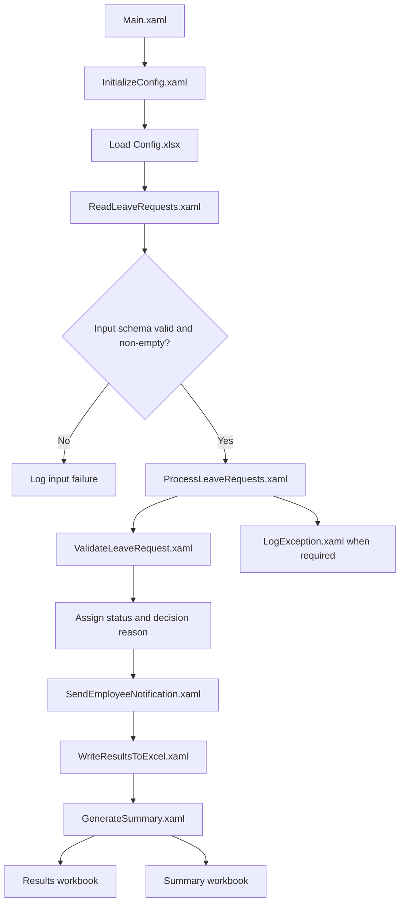

Employee Leave Request Automation
A modular Robotic Process Automation (RPA) solution built with UiPath Studio to process employee leave requests from Excel, validate them against configurable business rules, calculate working days, determine request outcomes, and generate detailed and summary reports.
Project status: Controlled UAT-ready. Local validation, build, and runtime testing have passed. Production use still requires HR policy approval, live email verification, and Orchestrator deployment verification.

Overview
The automation processes employee leave requests end to end:
1. Reads leave requests from an Excel workbook.
2. Loads configurable rules and paths from Config.xlsx.
3. Validates each request and checks for duplicate request IDs.
4. Calculates working days while excluding weekends and configured holidays.
5. Determines a consistent request status.
6. Optionally sends employee notifications.
7. Writes detailed outcomes to an Excel results workbook.
8. Generates a summary workbook with processing metrics.
9. Handles request-level exceptions and logs technical errors.
Key Features
- Excel integration: Reads request data and writes results and summary reports.
- Configurable business rules: Paths, leave thresholds, date policy, holiday dates, and notification settings are maintained in configuration.
- DataTable processing: Processes requests in a structured, row-by-row manner.
- Leave validation: Checks mandatory fields, duplicate IDs, email format, leave type, dates, working days, submitted day count, leave balance, and approval threshold.
- Decision-making: Assigns a deterministic status and reason for each request.
- Notification handling: Supports optional email notifications and tracks notification outcomes separately from leave decisions.
- Exception handling: Continues processing other rows when an individual request encounters an error, where possible.
- Reporting: Produces detailed results and a metrics summary.
- Credential safety: Uses a configured credential asset; passwords are not stored in Excel, XAML, source files, or logs.
Technology Stack
Component	Details
RPA platform	UiPath Studio
Project type	UiPath Windows Process
Target framework	Windows
.NET target	net10.0
Expression language	Visual Basic
Input / output	Microsoft Excel workbooks
Data processing	UiPath DataTable activities
Email	Configurable SMTP integration
Configuration	Config.xlsx
Main entry point	Main.xaml

The implementation report records Studio version 26.0.204.0-preview. Use a compatible UiPath Studio and activity-package environment when opening the project.
Workflow Architecture

Project Structure
EmployeeLeaveRequestAutomation_Studio26/
├── AGENTS.md
├── Config.xlsx
├── Main.xaml
├── project.json
├── project.uiproj
├── Workflows/
│   ├── GenerateSummary.xaml
│   ├── InitializeConfig.xaml
│   ├── LogException.xaml
│   ├── ProcessLeaveRequests.xaml
│   ├── ReadLeaveRequests.xaml
│   ├── SendEmployeeNotification.xaml
│   ├── ValidateLeaveRequest.xaml
│   └── WriteResultsToExcel.xaml
├── Data/
│   ├── LeaveRequests_Clean_Input.xlsx
│   ├── LeaveRequests_Input.xlsx
│   ├── LeaveRequests_Output.xlsx
│   ├── LeaveRequests_Summary.xlsx
│   └── LeaveRequests_Template.xlsx
└── Documentation/
    ├── BusinessRules.md
    ├── DashboardSetup.md
    ├── EmailTemplates.md
    ├── PackageVerification.md
    ├── README.md
    ├── RunSmokeTest.ps1
    ├── SmokeTestResults.md
    ├── TestCases.md
    ├── Troubleshooting.md
    └── ValidationStatus.md
The repository may omit generated Studio metadata, caches, temporary files, local logs, or output workbooks if they are unnecessary or contain sensitive data. Keep the project files and safe sample/template data required to understand and run the automation.

Business Rules
The workflow applies the configured rules below. These are sample/portfolio rules and must be reviewed against the applicable organization's leave policy before production use.
- Required request and employee fields must be present.
- Request IDs must be unique.
- Employee email addresses must have a valid basic format.
- Leave types must be supported by the configuration/business rules.
- Dates must be parseable and ordered correctly.
- Past dates are controlled by configuration.
- Working days exclude weekends and configured holidays.
- Submitted TotalDays must match the calculated working-day count.
- Annual leave requests must not exceed the available annual leave balance.
- Requests above the automatic approval threshold are routed to a pending status.
- Manager information is required when the request requires manager approval.
- Unexpected technical failures are recorded as Error; they are not treated as approvals.
Request Statuses
Status	Meaning
Approved	Validation passed and the request is within the automatic approval threshold.
Rejected	A configured business rule failed. A decision reason is recorded.
Pending Manager Approval	Validation passed, but the request exceeds the automatic approval threshold and requires manager review.
Error	An unexpected technical failure occurred or required manager information is missing.

A request-level Error does not necessarily mean the overall UiPath job failed; the process can continue and record the row outcome.
Input Data
The input workbook is Data/LeaveRequests_Input.xlsx, using the configured input worksheet (default: LeaveRequests).

Expected columns:
Column	Description
RequestID	Unique leave request identifier
EmployeeID	Employee identifier
EmployeeName	Employee name
Email	Employee email address
Department	Employee department
LeaveType	Requested leave category
StartDate	First requested leave date
EndDate	Last requested leave date
TotalDays	Submitted number of leave days
Reason	Leave reason
AnnualLeaveBalance	Available annual leave balance
ManagerEmail	Manager email address

Use fictional or anonymized records for demonstrations and testing. Do not commit real employee leave data to a public repository.
Output Reports
Detailed results
Generated at the configured output path (default: Data/LeaveRequests_Output.xlsx) on the LeaveResults worksheet.

The report includes the original request fields plus calculated days, status, decision reason, processing date, notification status, and notification error information.
Summary report
Generated at the configured path (default: Data/LeaveRequests_Summary.xlsx) on the Summary worksheet.

Summary metrics include:
- Total requests
- Approved
- Rejected
- Pending manager approval
- Errors
- Notifications sent
- Notifications failed
Configuration
The project reads settings from Config.xlsx. Current documented defaults include:
Setting	Default
NotificationEnabled	False
EmailProvider	SMTP
SenderDisplayName	HR Automation System
SmtpHost	smtp.office365.com
SmtpPort	587
ApprovalThreshold	5
AllowPastDates	False
MaxEmailRetries	2
InputSheet	LeaveRequests
OutputSheet	LeaveResults
InputPath	Data\LeaveRequests_Input.xlsx
OutputPath	Data\LeaveRequests_Output.xlsx
LogFolder	Logs
EmailCredentialAsset	EmployeeLeaveSmtpCredential

Configuration values are examples and should be changed to match the intended environment and approved policy.
Setup and Run
1. Install a UiPath Studio version compatible with the project and its dependencies.
2. Clone or download this repository.
3. Open project.uiproj in UiPath Studio.
4. Restore the required activity packages.
5. Review Config.xlsx and confirm the input/output paths and business-rule settings.
6. Review the input workbook schema and use fictional test data.
7. Keep NotificationEnabled=False until email credentials, provider settings, and an authorized test mailbox are configured.
8. Close the output workbooks in Excel before running the automation to avoid file-lock errors.
9. Open Main.xaml and run the process.
10. Review Data/LeaveRequests_Output.xlsx and Data/LeaveRequests_Summary.xlsx.
Email Setup
Email notifications are optional and disabled by default. Before enabling them:
- Configure the approved email provider and sender.
- Configure the required credential asset (EmployeeLeaveSmtpCredential) in the appropriate credential store/Orchestrator folder.
- Confirm the robot identity has access to the credential.
- Verify the provider's supported authentication and security requirements.
- Perform a controlled test using an authorized test mailbox.
- Confirm notification outcomes in the results workbook.
Never put email passwords, tokens, or secrets in Config.xlsx, XAML files, GitHub, or logs.
Verification and Test Results
The implementation report documents the following verification:
- Package restore: passed.
- Validation of all 9 XAML workflows: passed with no diagnostics.
- Full project build: passed.
- Runtime execution from UiPath Studio: passed.
- Runtime execution from Command Prompt: passed.
- Normal 12-row failure-injection test: completed.
- Isolated clean 5-row test: completed.
- Detailed results workbook generation: passed.
- Summary workbook generation: passed.
Recorded test outcomes
12-row test
Metric	Result
Total requests	12
Approved	3
Rejected	7
Pending manager approval	1
Errors	1
Notifications sent	0
Notifications failed	0

Clean 5-row test
Metric	Result
Total requests	5
Approved	5
Rejected	0
Pending manager approval	0
Errors	0
Notifications sent	0
Notifications failed	0

Notifications were disabled during these tests. These results reflect the test evidence in the implementation report; they do not represent live email delivery verification.
Current Limitations and Production Readiness
The project is controlled UAT-ready, not fully production-deployed.

Before production use, complete and verify:
- HR approval of leave types, working-day rules, holidays, leave balances, thresholds, manager approval, privacy, and retention policies.
- Live controlled email delivery testing.
- Credential asset and robot permission verification.
- UiPath package publication and Orchestrator process deployment.
- Orchestrator smoke job, output storage, scheduling, and monitoring verification.
- Additional infrastructure-failure testing.
Troubleshooting
- Excel file is locked: Close LeaveRequests_Output.xlsx and LeaveRequests_Summary.xlsx, then rerun.
- Input file or worksheet missing: Check InputPath, InputSheet, and the expected input columns in Config.xlsx.
- Unexpected request status: Review DecisionReason and the configured business rules.
- Notification not sent: Confirm NotificationEnabled, email configuration, credential asset access, and the request's status/email validity.
- Package or XAML validation error: Restore compatible activity dependencies and validate the project in the intended Studio version.
- Orchestrator execution not available: Confirm that the project has been published, the process created in the correct folder, and the robot has the required permissions.
See the Documentation/ folder for business rules, test cases, package verification, smoke test evidence, and troubleshooting details.
Security and Privacy
- Use fictional or anonymized sample data in the repository.
- Do not commit credentials, access tokens, or secrets.
- Do not publish actual employee personal or leave information.
- Keep sensitive logs and runtime outputs out of public repositories.
- Review .gitignore before committing generated files and local configuration.
Future Enhancements
Potential improvements include:
- Manager approval integration with a formal approval workflow.
- UiPath Apps dashboard for request search, status filters, and summary metrics.
- Orchestrator deployment and unattended scheduling.
- Provider-specific OAuth/Microsoft 365 email integration.
- Audit trail, retention controls, and expanded infrastructure-failure tests.
Author
Project: Employee Leave Request Automation
Platform: UiPath Studio
Purpose: RPA learning, portfolio demonstration, and controlled user acceptance testing
